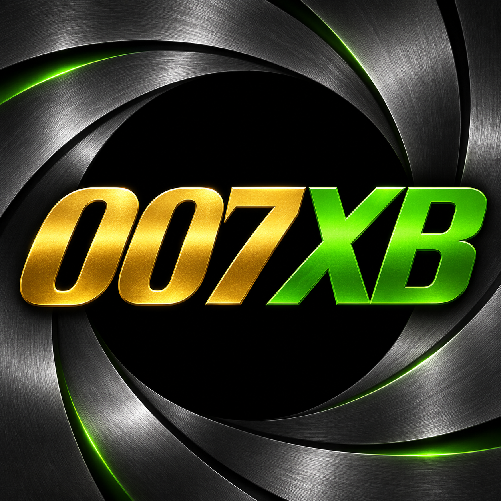

<p align="center">
  
</p>
<p align="center">
  &nbsp;&nbsp;
  
</p>

# 007xb

**GoldenEye 007, ported natively to the original Xbox.** A project by **Darkone83**, built on the [GoldenEye 007 decompilation](https://github.com/n64decomp/007) and [GoldenEye 007 PC port](https://github.com/jkdansereau/goldeneye-pc-port), with single-player missions, local split-screen, and LAN multiplayer.

## Getting started

1. Download/extract this repository. You must supply your **own clean US/NTSC-U GoldenEye 007 Nintendo 64 ROM**; the game ROM and generated assets are not provided.
2. On Windows, open **`tools/Start 007xb.cmd`** (or `tools/007xb Asset Studio.pyw` with Python 3.10+ and Tkinter). Select your ROM and click **Build Archive**. See [packer instructions](tools/README.md) if needed.
3. The packer creates **`data/007xb_assets.dat`** in the repository folder. Copy that **single file** into **`xbe/data/`**. No loose extracted assets are required.
4. Copy the contents of **`xbe/`** to a folder on your original Xbox so the layout is:

   ```text
   default.xbe
   data/
     007xb_assets.dat
   ```

5. Launch **`default.xbe`** from your Xbox dashboard.

The runtime loads the archive at `D:\data\007xb_assets.dat` (`D:` represents the running title's folder). A prepared XBE may be supplied in `xbe/` where redistribution is permitted; the ROM and generated `.dat` are **never** part of the source release.

## Multiplayer

Open **Multiplayer** and choose how you want to play:

| Menu option | Players | Experience |
| --- | --- | --- |
| **LOCAL - split-screen** | 2–4 players on one Xbox | Split-screen multiplayer using connected controllers. |
| **LAN - linked consoles** | 2–4 Xbox consoles, one player per console | Each console displays its own player's view in the same multiplayer match. |

### LAN setup

Connect the consoles to the same local network through a router or Ethernet switch. Each console needs a working IP address on the same subnet, a controller, the same **007xb build**, and the same **007xb_assets.dat** archive.

LAN games use **UDP port 27007** with automatic host discovery. Buffered inputs and packet retries help accommodate latency and jitter on the local network.

### Hosting and joining

1. On every console, select **Multiplayer → LAN - linked consoles**.
2. On one console, choose **HOST GAME**.
3. On the other consoles, choose **JOIN GAME**, highlight the host, and press **A**. The browser shows available hosts, their player counts, and IP addresses. Press **START** to refresh or **B** to cancel.
4. In the lobby, the host can use the **NEXT** tab to open **LAN MATCH RULES** and choose the scenario, stage, game length, weapons, and other shared match settings. Other players can view the rules.
5. Each player chooses a **Character** preset, **Controls**, and **Health** where the scenario allows it. Press **A** or use left/right to change a highlighted option. Control styles include **1.1 Honey**, **1.2 Solitaire**, **1.3 Kissy**, **1.4 Goodnight**, and **1.5 Halo**.
6. Every player, including the host, highlights **NOT READY - A to confirm** and presses **A**. The row changes to **READY - A to change**. Shared rule changes require players to ready up again.
7. Once everyone is ready, the host presses **START**. The match begins after all consoles finish loading.

LAN uses one player per console; choose **LOCAL - split-screen** for multiple players sharing one Xbox. Players join through the lobby before a round starts.

### Leaving a LAN game

Press **B** to leave the lobby. During a match, press **START**, choose **EXIT** in the multiplayer menu, and confirm.

If any player leaves, disconnects, loses their controller connection, or stops responding, the session ends for everyone and returns to the **HOST GAME / JOIN GAME** screen with the reason displayed. Start another session through **HOST GAME** and **JOIN GAME**.

## Repository

`src/` — engine and Visual Studio source · `tools/` — asset packer, build utilities, scripts · `images/` — preview and branding · `xbe/` — launchable XBE and initially empty `data/` folder · `docs/` — development and release notes.

**Development notes:** [Technical findings](docs/TECHNICAL_FINDINGS.md) · [Building from source](docs/BUILD_NOTES.md) · [Contributing](CONTRIBUTING.md) · [Licensing](LICENSING.md) · [Credits and third-party notices](THIRD_PARTY_NOTICES.md)

**Disclaimer:** Independent fan-made port. Not affiliated with or endorsed by Rare, Nintendo, Microsoft, or the James Bond / GoldenEye rights holders. All trademarks and original game content belong to their respective owners.
