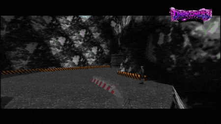
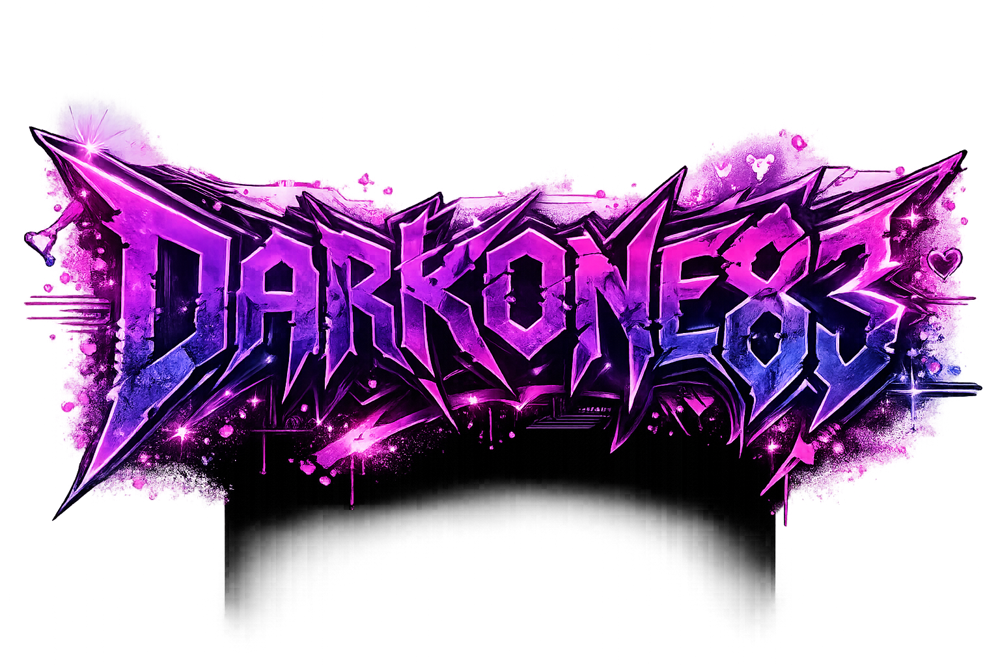

<p align="center">
  
</p>
<p align="center">
  &nbsp;&nbsp;
  
</p>

# 007xb

**GoldenEye 007, ported natively to the original Xbox.** A work-in-progress project by **Darkone83**, built on the [GoldenEye 007 decompilation](https://github.com/n64decomp/007) and [GoldenEye 007 PC port](https://github.com/jkdansereau/goldeneye-pc-port). Currently in real-hardware playtesting; expect bugs and incomplete features.

## Getting started

1. Download/extract this repository. You must supply your **own clean US/NTSC-U GoldenEye 007 Nintendo 64 ROM**; the game ROM and generated assets are not provided.
2. On Windows, open **`tools/Start 007xb.cmd`** (or `tools/007xb Asset Studio.pyw` with Python 3.10+ and Tkinter). Select your ROM and click **Build Archive**. See [packer instructions](tools/README.md) if needed.
3. The packer creates **`data/007xb_assets.dat`** in the repository folder. Copy that **single file** into **`xbe/data/`**. No loose extracted assets are required.
4. Copy the contents of **`xbe/`** to a folder on your original Xbox so the layout is:

   ```text
   default.xbe
   data/
     007xb_assets.dat
   ```

5. Launch **`default.xbe`** from your Xbox dashboard.

The runtime loads the archive at `D:\data\007xb_assets.dat` (`D:` represents the running title's folder). A prepared XBE may be supplied in `xbe/` where redistribution is permitted; the ROM and generated `.dat` are **never** part of the source release.

## Repository

`src/` — engine and Visual Studio source · `tools/` — asset packer, build utilities, scripts · `images/` — preview and branding · `xbe/` — launchable XBE and initially empty `data/` folder · `docs/` — development and release notes.

**Development notes:** [Technical findings](docs/TECHNICAL_FINDINGS.md) · [Building from source](docs/BUILD_NOTES.md) · [Contributing](CONTRIBUTING.md) · [Licensing](LICENSING.md) · [Credits and third-party notices](THIRD_PARTY_NOTICES.md)

**Disclaimer:** Independent fan-made port. Not affiliated with or endorsed by Rare, Nintendo, Microsoft, or the James Bond / GoldenEye rights holders. All trademarks and original game content belong to their respective owners.
